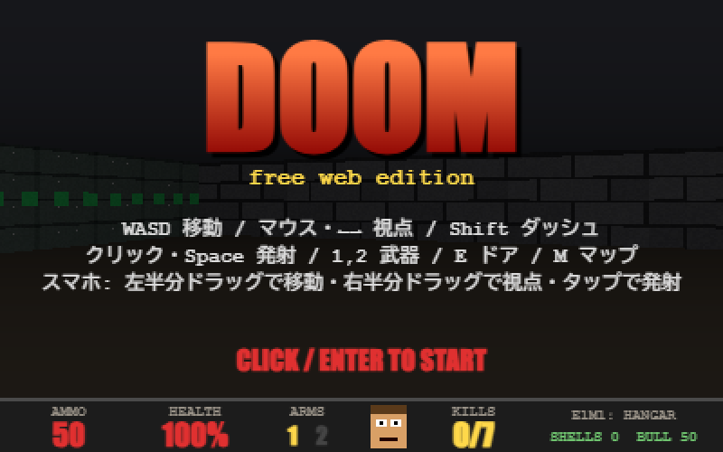
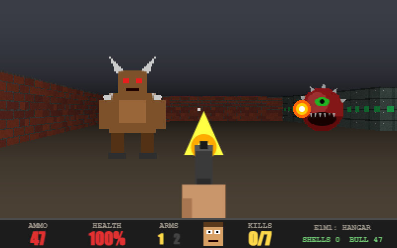
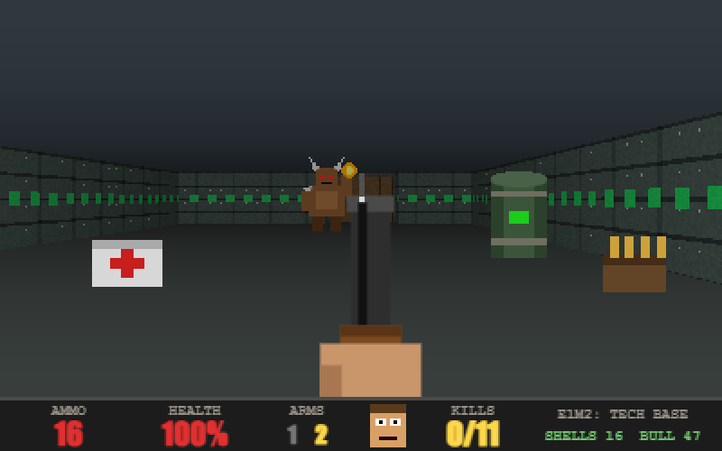
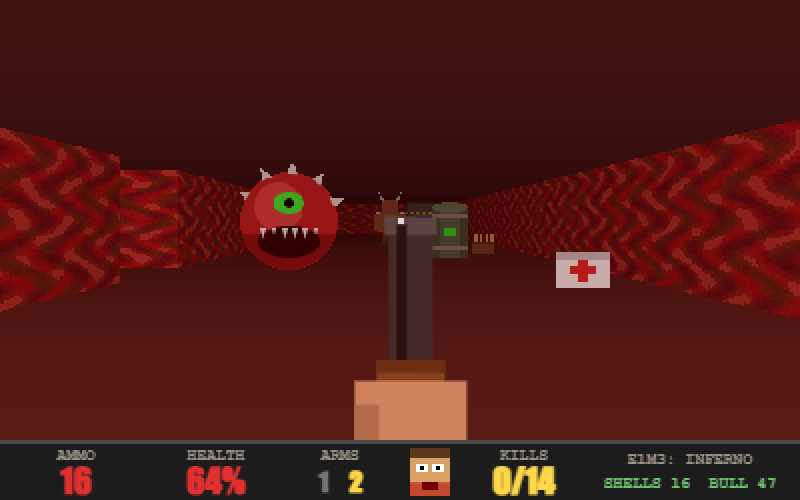

# freeDoom

ブラウザだけで動く DOOM 風 FPS です。外部アセット・ライブラリなし、`index.html` 1ファイルで完結しています。

**▶ プレイする: https://freedoom-eta.vercel.app**



## スクリーンショット

| E1M1: HANGAR | E1M2: TECH BASE |
| --- | --- |
|  |  |

| E1M3: INFERNO |
| --- |
|  |

## 遊び方

| 操作 | キー |
| --- | --- |
| 移動 | W A S D（Shift でダッシュ） |
| 視点 | マウス（クリックでポインタロック）/ ← → |
| 発射 | クリック / Space / Ctrl |
| 武器切替 | 1（ピストル）/ 2（ショットガン、散弾を拾うと解放） |
| ドア | 近づくと自動で開く（E でも開く） |
| マップ | M / Tab |

スマホ: 画面左半分のドラッグで移動、右半分のドラッグで視点、タップで発射。

3ステージ構成。壁の `EXIT` パネルに触れるとステージクリアです。

## 技術

- Canvas 2D + 独自レイキャスター（DDA）。壁テクスチャ・スプライトはすべて実行時に手続き生成
- スライド式ドア、Zバッファによるスプライト遮蔽、距離フォグ
- 敵 AI（待機 → 追跡 → 近接 / 火球）、爆発する樽、回復・弾薬アイテム
- 効果音は WebAudio で合成（音声ファイルなし）

## ローカル実行

```bash
python3 -m http.server 8000
```

`http://localhost:8000/` を開きます。`index.html` を直接ダブルクリックしても動きます。

## Vercel へのデプロイ

ビルド不要の静的サイトです。

1. Vercel で **Add New → Project** を選び、この GitHub リポジトリ（`metal-saito/freeDoom`）をインポート
2. Framework Preset は **Other**、Build Command と Output Directory は空のまま **Deploy**

CLI の場合:

```bash
npx vercel --prod
```
